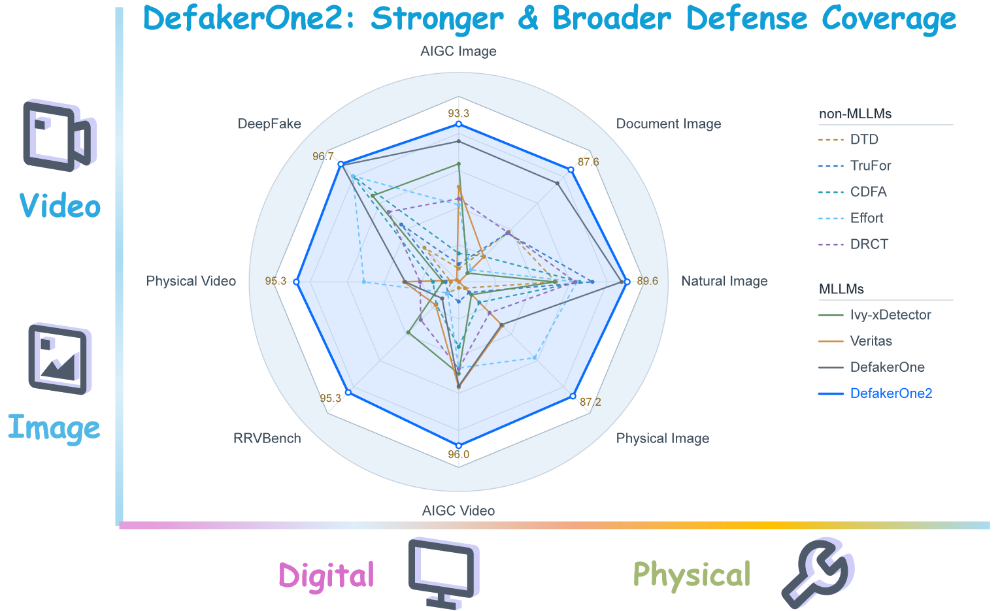
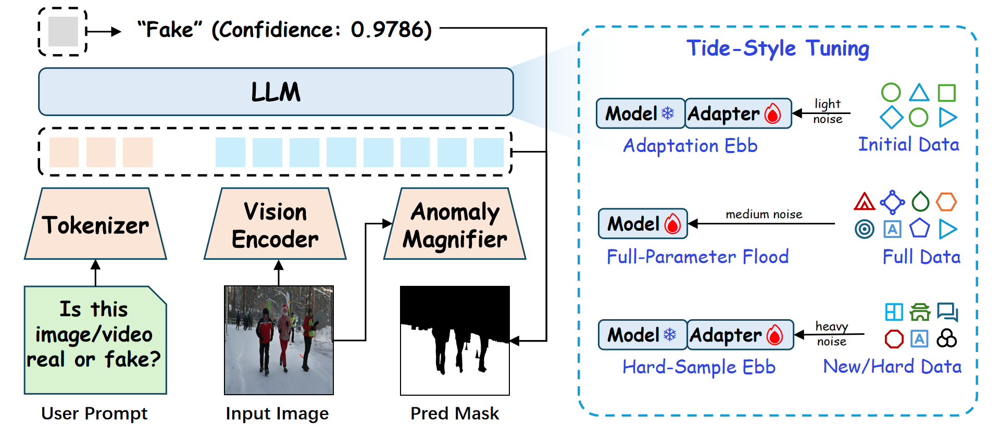
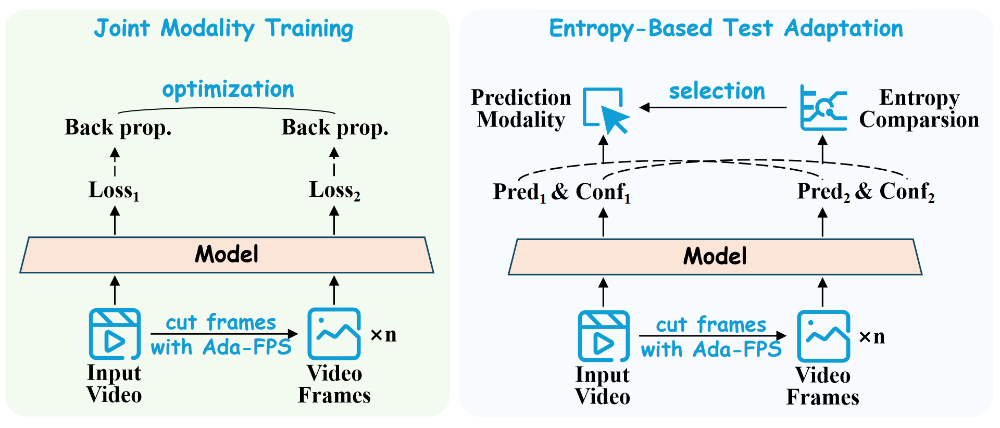
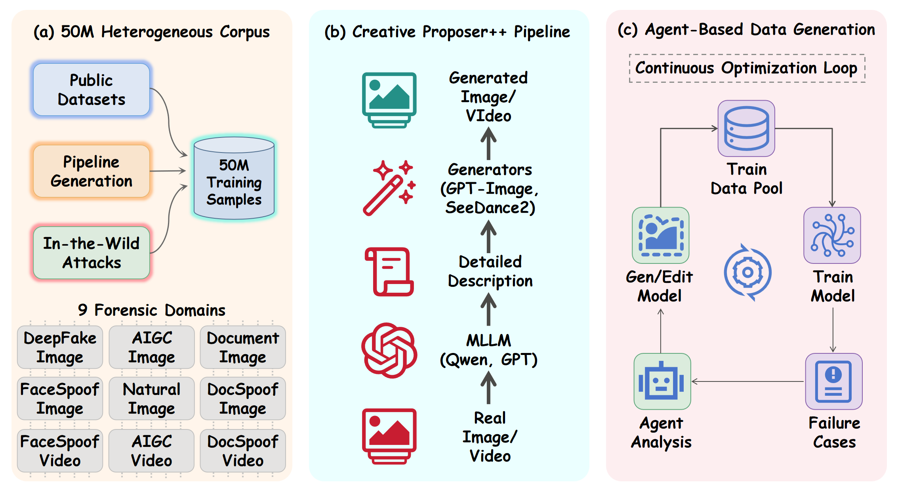

<p align="center">
  
</p>

---

<p align="center">
  <a href="assets/Venus-DefakerOne2.pdf">📄 Technical Report</a> •
  <a href="https://venus-guangjian.github.io/Venus-DeFakerOne2/">🌐 Project Page</a> •
  <a href="#overview">✨ Overview</a> •
  <a href="#benchmark-results">📊 Results</a> •
  <a href="#rrvbench">🎬 RRVBench</a> •
  <a href="#quick-start">🛠️ Quick Start</a> •
  <a href="#citation">📚 Citation</a>
</p>

<h2 align="center">
  Venus-DefakerOne2: A Vision-Forensics Foundation Model<br>
  with Broader Coverage
</h2>

<p align="center">
  <b>GuangJian Team, Ant Group</b><br>
  <b>Technical Committee on Digital Media Forensics and Security, CSIG</b>
</p>

<p align="center">
  <a href="https://github.com/inclusionAI/DefakerOne2"></a>
  <a href="https://www.modelscope.cn/models/DanceText/DefakerOne2"></a>
  <a href="https://www.modelscope.cn/models/DanceText/RRVBench"></a>
  <a href="https://venus-guangjian.github.io/Venus-DeFakerOne2/"></a>
</p>

<p align="center">
  
</p>

*DefakerOne2 significantly expands defense coverage along both the **forgery-form** (digital → digital + physical) and **media-type** (image → image + video) dimensions, and consistently outperforms its predecessor DefakerOne and existing state-of-the-art detectors across all image and video forensic domains.*

**DefakerOne2** is a unified vision-forensics foundation model that brings AI-generated content detection, DeepFake face detection, document tampering detection, natural-image manipulation detection, face/document anti-spoofing, and AI-generated video detection into **one 2B-parameter model** — covering the full matrix of **{digital, physical} × {image, video}**.

## Release

- **2026-10-31:** Technical report and [project page](https://venus-guangjian.github.io/Venus-DeFakerOne2/) are available.
- **2026-10-29:** DefakerOne2 model weights are released on [ModelScope](https://www.modelscope.cn/models/DanceText/DefakerOne2); the RRVBench benchmark is released on [ModelScope](https://www.modelscope.cn/models/DanceText/RRVBench).

## Contents

- [Overview](#overview)
- [Capability Coverage](#capability-coverage)
- [Method](#method)
- [Training Data](#training-data)
- [Benchmark Results](#benchmark-results)
- [RRVBench](#rrvbench)
- [Quick Start](#quick-start)
- [Model Zoo](#model-zoo)
- [Citation](#citation)
- [Acknowledgments](#acknowledgments)
- [License](#license)

## Overview

Real-world forgery is inherently heterogeneous: it manifests not only as **digital manipulation** but also as **physical spoofing**, and is carried not only by **images** but also by **videos**. Digital image forensics, face anti-spoofing, document fraud detection, and video forensics have long been studied in largely separate communities, each maintaining its own benchmarks, assumptions, and model designs — even though the underlying goal is identical: distinguishing genuine media from forged ones.

DefakerOne2 collapses this fragmented assembly of scenario-specific detectors into **one deployable foundation model**. Trained on a heterogeneous corpus of about **50M samples** consolidated from public datasets, self-synthesized data, and manually annotated in-the-wild attack samples, it incorporates three key designs:

- **Tide-Style Tuning.** A three-phase schedule in which the trainable-parameter budget ebbs and flows — LoRA → full-parameter → LoRA — reconciling computational efficiency, generalization, and hard-sample fitting while mitigating catastrophic forgetting.
- **Modality Synergism.** Joint video/frame training plus entropy-based test adaptation, which routes each sample at inference time to the modality carrying the stronger forensic evidence, with no extra training and no learned routing module.
- **Anomaly Magnifier + Calibration Loop.** A DINOMAC-based auxiliary encoder for fine-grained cues, coupled with a global-judgment-conditioned pixel threshold, so a single model produces both image/video-level verdicts and pixel-level localization masks.

Evaluated on **53 detection benchmarks** and **14 localization benchmarks**, DefakerOne2 achieves state of the art on **40/53** and **11/14** of them respectively, and ranks **first in all eight forensic domains** — never outperformed by a domain specialist even on that specialist's own domain.

| Highlight | DefakerOne (V1) | **DefakerOne2 (V2)** |
| --- | ---: | ---: |
| Image-domain average | 80.4 | **90.9** |
| Video-domain average | 57.6 | **95.7** |
| Physical forgery (image) | 50.7 | **87.2** |
| Physical forgery (video) | 50.7 | **95.8** |
| ManipulatedBench (zero-shot bACC) | 48.6 | **71.7** |
| RRVBench (zero-shot bACC) | 52.3 | **95.3** |
| Detection SOTA | 10 / 53 | **40 / 53** |
| Localization SOTA | 1 / 14 | **11 / 14** |

## Capability Coverage

| | **Image** | **Video** |
| --- | --- | --- |
| **Digital** | AI-generated images · DeepFake faces · tampered documents · manipulated natural images | AI-generated videos (GenBuster-ID / GenBuster-OOD / GenBuster++, LOKI, VideoPhy2, RABench, RRVBench) |
| **Physical** | Presentation attacks on face and ID-card images · print attacks · replay attacks · mask attacks | Presentation attacks on face and ID-card videos (CASIA-FASD, DLC2021, SCVD) |

Beyond binary decisions, DefakerOne2 also provides **pixel-level tamper localization** on both document and natural images, and emits a **confidence score** with every verdict from a single decision token — the property required for evidence presentation and threshold-based operation in a real moderation pipeline.

## Method

<p align="center">
  
</p>

**Architecture.** DefakerOne2 is built on the **Qwen3.5-2B** multimodal backbone, extended with an **Anomaly Magnifier (AM)** auxiliary encoder based on **[DINOMAC](https://github.com/qcf-568/DINOMAC)** (DINOv3-Large fine-tuned with LoRA adapters and forensic training strategies). Features from the MLLM vision encoder and the AM module are fused by a convolutional mask decoder for pixel-level prediction. Detection uses a fixed, direct prompt — *"Is this image/video real or fake? Answer only Real or Fake."* — so the model commits to its conclusion in a **single output token**, maximizing inference efficiency and the stability of the predicted confidence.

### 1. Tide-Style Tuning

| Phase | Trainable scope | Data | DINOMAC noise | Purpose |
| --- | --- | --- | --- | --- |
| **① Adaptation Ebb** | LoRA adapter (backbone frozen) | Initial ~15M | light | Low-cost warm-up; adapts Qwen3.5 to forensics while preserving world knowledge for implicit semantic reasoning |
| **② Full-Parameter Flood** | All parameters (LoRA merged into backbone) | Full ~40M | medium | Releases the whole parameter budget to fit the large-scale heterogeneous corpus |
| **③ Hard-Sample Ebb** | Fresh LoRA adapter (backbone frozen) | Full + New / hard ~40M | heavy | Acts as an implicit regularizer; steers the model to hard and newly collected samples at low continued-training cost |

Progressively intensifying adversarial noise discourages memorization of trivially easy samples and improves robustness. Ablation (Table 20 of the report):

| Setting | All-LoRA | All-Full | Ours (Stage 1) | Ours (Stage 2) | **Ours (Stage 3)** |
| --- | ---: | ---: | ---: | ---: | ---: |
| Image average | 87.3 | 87.8 | 84.6 | 88.4 | **90.9** |
| Video average | 93.6 | 93.0 | 91.8 | 94.2 | **95.7** |

Neither static parameterization dominates — the bottleneck is not the *amount* of trainable parameters but the *schedule* by which they are released.

### 2. Modality Synergism

<p align="center">
  
</p>

Which modality carries stronger evidence is **sample-dependent and unknown a priori**: some forgeries concentrate in single-frame texture (over-smoothing, boundary artifacts), others in temporal dynamics (flickering, motion inconsistency, disrupted inter-frame continuity).

- **Joint modality training.** Every video is presented in both modalities simultaneously — the native clip and an **Ada-FPS** frame sequence — with an independent detection loss on each, back-propagated into the shared backbone: `L = ℓ(p_vid, y) + ℓ(p_img, y)`. Ada-FPS equalizes the frame budget across long-tailed video sources (default `f₀ = 1 FPS`, capped at `f_max = 10 FPS`).
- **Entropy-based test adaptation.** Both pathways produce a prediction with confidence; the Shannon entropy `H_m = −c_m log c_m − (1−c_m) log(1−c_m)` measures certainty, and the more certain modality is adopted: `ŷ = ŷ_{m*}`, `m* = argmin_m H_m`. At inference the first and last 10% of each clip are discarded and the middle 80% is sampled with Ada-FPS.

Ablation (Table 21, same weights, ten video benchmarks):

| Pathway | Frame-only | Video-only | **Entropy-routed** |
| --- | ---: | ---: | ---: |
| Average accuracy | 91.6 | 93.5 | **95.9** |
| Selection ratio | 50.0% | 50.0% | — |

The two pathways are complementary rather than ordered — frames win on RABench (98.2 vs 87.4) and RRVBench (97.6 vs 85.2), video wins on SCVD (95.1 vs 71.9) and GenBuster++ (88.4 vs 72.2). On four benchmarks the routed predictor **exceeds both** fixed modalities, and the 50/50 average selection ratio confirms genuinely sample-adaptive routing rather than a collapsed global preference.

### 3. Calibration Loop

A pixel decoder trained only with region-wise supervision treats every input identically and tends to over-segment authentic content. DefakerOne2 conditions the localization boundary on the global judgment `p`:

```text
τ(p) = 0.75 − p/2 = 1/2 + 1/2 · (1/2 − p)
M_cal = 1[ M > τ(p) ]
```

When the MLLM is confident the content is forged (`p → 1`), the boundary drops to `0.25` and weak-but-genuine tampering cues survive; when it judges the content authentic (`p → 0`), the boundary rises to `0.75` and only highly salient anomalies pass. At `p = 0.5` the loop degenerates to conventional fixed-threshold binarization, so the calibration never injects a bias unsupported by global evidence. In log-odds space the shift is antisymmetric and bounded within `±log 3 ≈ ±1.099`, letting the decoder still disagree with the global branch when pixel evidence is strong enough.

## Training Data

<p align="center">
  
</p>

The ~50M-sample corpus integrates three provenance tiers — **public datasets**, **engine-synthesized data**, and **manually curated in-the-wild attack samples**.

**Creative Proposer++.** An MLLM (Qwen3.5-32B / GPT-5.5) first produces a detailed description of a *real* image or video, which then conditions a generator (GPT-Image-2, SeeDance 2.5, …) to synthesize its counterfeit. Real and fake counterparts are therefore **semantically aligned by construction**, preventing the detector from latching onto content cues irrelevant to forgery, while inheriting the diversity of real-world media instead of template-based prompts.

**Agent-based data generation.** A closed loop of *training → failure-case analysis → targeted synthesis → re-training*: an agent inspects bad cases, identifies missing forgery patterns, selects suitable generation/editing models to synthesize targeted samples, and feeds them back into the training pool — so newly emerging attacks become the input of the next capability round.

## Benchmark Results

Selected results from the technical report. Domain-wise summary over all eight domains (report Table 19); **higher is better in every column**.

| Domain | DTD | FFDN | TruFor | CDFA | Effort | DRCT | F.MoE | Ivy-xDet. | Veritas | DefakerOne | **DefakerOne2** |
| --- | ---: | ---: | ---: | ---: | ---: | ---: | ---: | ---: | ---: | ---: | ---: |
| *Image* · DeepFake (AUC) | 36.8 | 57.4 | 53.4 | 87.9 | 88.2 | 62.4 | 40.9 | 74.0 | 13.6 | 95.8 | **96.7** |
| *Image* · AIGC (Acc) | 44.7 | 49.5 | 46.2 | 49.8 | 66.1 | 68.2 | 57.7 | 79.9 | 72.2 | 87.5 | **93.3** |
| *Image* · Document (Acc) | 59.1 | 56.6 | 58.5 | 47.8 | 41.7 | 58.8 | 42.0 | 40.2 | 47.7 | 81.4 | **87.6** |
| *Image* · Natural (AUC) | 52.5 | 34.8 | 71.5 | 64.7 | 63.4 | 62.5 | 25.6 | 51.8 | 2.0 | 86.7 | **89.6** |
| *Image* · Physical (Acc) | 32.0 | 60.0 | 34.2 | 39.3 | 67.6 | 44.6 | 31.9 | 35.5 | 51.2 | 50.7 | **87.2** |
| **Image average** | 45.0 | 51.7 | 52.8 | 57.9 | 65.4 | 59.3 | 39.6 | 56.3 | 37.3 | 80.4 | **90.9** |
| *Video* · Digital (Acc) | 36.7 | 53.9 | 39.4 | 52.1 | 59.6 | 62.1 | 45.8 | 64.4 | 70.4 | 69.9 | **96.1** |
| *Video* · Physical (Acc) | 32.0 | 60.0 | 34.2 | 39.3 | 67.6 | 44.6 | 31.9 | 35.3 | 51.2 | 50.7 | **95.8** |
| *Video* · RRVBench (bACC) | 50.0 | 50.8 | 49.7 | 55.0 | 49.8 | 62.1 | 52.4 | 67.8 | 55.3 | 52.3 | **95.3** |
| **Video average** | 39.6 | 54.9 | 41.1 | 48.8 | 59.0 | 56.3 | 43.4 | 55.8 | 59.0 | 57.6 | **95.7** |

DefakerOne2 attains the best score on **all eight rows**; the margin over the strongest external competitor in each row is never smaller than **8.5** points (DeepFake, vs Effort) and reaches **28.5** points on document images (vs DTD). Competitor averages are almost flat while their per-domain rankings rotate — a model that is best on one row can be near-chance on another — whereas our own spread is narrow (87.2–96.7 for images, 95.3–96.1 for videos), i.e. unified training does not trade one domain against another.

**Video forgery detection** (accuracy / HTER, eight classic physical + digital benchmarks):

| Metric | FLIP | MVP | Effort | DRCT | BusterX | VideoVeritas | Veritas | DefakerOne | **DefakerOne2** |
| --- | ---: | ---: | ---: | ---: | ---: | ---: | ---: | ---: | ---: |
| Average Acc ↑ | 60.4 | 69.8 | 62.6 | 55.5 | 52.5 | 68.3 | 63.2 | 62.7 | **96.0** |
| Average HTER ↓ | 40.7 | 31.6 | 41.1 | 37.1 | 34.8 | 27.9 | 29.9 | 29.4 | **5.0** |

**RA-Bench** (zero-shot, nine unseen generators): DefakerOne2 reaches **99.3** average AUC and **96.3** average balanced accuracy, versus 61.1 AUC for the best image detector (ForgeLens), 60.9 for the best video detector (DeCoF), 63.4 bACC for Gemini-3.1-Pro-Preview, 54.9 for Skyra-RL, and 49.3 for DefakerOne. Its worst generator beats every competitor's best generator.

**Pixel-level localization** (binary F1):

| Block | TruFor | DTD | APSC-Net | Mesorch | CAFTB | TIFDM | DefakerOne | **DefakerOne2** |
| --- | ---: | ---: | ---: | ---: | ---: | ---: | ---: | ---: |
| Document average | — | 60.1 | — | — | 46.5 | 36.7 | 73.7 | **79.5** |
| Natural average | 50.3 | — | 58.7 | 52.0 | — | — | 67.4 | **78.1** |

**Robustness & stability.** On MFFI-Distorted (blur, noise, color distortion, geometric deformation, sharpening, compression, adversarial perturbation), AUC drops only **7.4** points (97.3 → 90.1), versus a 20.5-point drop for DefakerOne (96.1 → 76.4). Across random seeds (42 / 1024 / 4096) and decoding temperatures (0.0 / 0.5 / 1.0), image accuracy stays within 90.8–91.0 and video accuracy within 95.5–95.7.

**Downstream fine-tuning on real-world attacks.** With identical in-house training data and a common operating point of **FPR = 0.001**, recall on four in-house real-world attack test sets:

| Pre-trained model | Data1 | Data2 | Data3 | Data4 | Avg1 | Avg2 |
| --- | ---: | ---: | ---: | ---: | ---: | ---: |
| DefakerOne (V1) | 94.11 | 86.12 | 81.12 | – | 87.12 | – |
| InternVL2-2B | 87.37 | 73.33 | 85.94 | – | 82.21 | – |
| Qwen3.5-2B | 93.93 | 87.54 | 92.77 | – | 91.41 | – |
| SwinTransformer | 95.13 | 81.63 | 72.59 | 15.66 | 83.12 | 66.25 |
| DINO-MAC-0.3B | 93.92 | 90.47 | 92.78 | 79.86 | 92.39 | 89.26 |
| **DefakerOne2-0.8B** | 94.92 | 94.19 | 95.58 | 80.61 | 94.90 | 91.33 |
| **DefakerOne2-2B** | **95.70** | **97.39** | **95.98** | **82.41** | **96.36** | **92.87** |

## RRVBench

<table>
  <tr>
    <td></td>
    <td></td>
    <td></td>
  </tr>
  <tr>
    <td></td>
    <td></td>
    <td></td>
  </tr>
  <tr>
    <td></td>
    <td></td>
    <td></td>
  </tr>
  <tr>
    <td></td>
    <td></td>
    <td></td>
  </tr>
  <tr>
    <td></td>
    <td></td>
    <td></td>
  </tr>
  <tr>
    <td></td>
    <td></td>
    <td></td>
  </tr>
</table>


Fake videos in public video-forensics datasets are typically produced by generators released more than a year ago. **RRVBench (Realistic Rumor Video Benchmark)** keeps evaluation aligned with the frontier of AIGC video generation:

- **1,319 authentic videos** (sourced from [RABench](https://arxiv.org/abs/2608.14391)) + **11,000 synthetic videos** from **11 modern generators**.
- **Closed-source engines (2,500):** SeeDance-2.5 (700), Happyhorse-1.1 (400), Vidu2-Image (400), Wan-2.6-Flash (400), Wan-2.6 (200), Kling-V3 Video (200), Kling-V3-Omni Video (200).
- **Open-source engines (8,500):** JoyAI-Echo (3,920), MiniMax-H3 (3,336), HunYuan-Video-1.5 (740), LongCatVideo (504).
- **Semantic-bias mitigation.** Following Creative Proposer++, Qwen3.5-32B extracts granular descriptions from the authentic source videos, which then condition the generators — so detectors are evaluated on *synthesis artifacts*, not on high-level contextual or thematic cues.
- **Target domains.** High-impact rumor scenarios: military actions, political events, civil unrest, and public-health emergencies.
- **Protocol.** Each generator subset is paired against the full unified authentic set; balanced accuracy is computed per generator and macro-averaged over the 11 subsets.

**🤗 Download:** [modelscope.cn/models/DanceText/RRVBench](https://www.modelscope.cn/models/DanceText/RRVBench)

Zero-shot results (balanced accuracy, averaged over the 11 generator subsets):

| BusterX | Ivy-xDetector | VideoVeritas | Veritas | DRCT | DefakerOne | **DefakerOne2** |
| ---: | ---: | ---: | ---: | ---: | ---: | ---: |
| 56.4 | 67.8 | 69.8 | 55.3 | 62.1 | 52.3 | **95.3** |

Nine of the ten non-MLLM detectors score within 48.2–56.2 — statistically indistinguishable from random guessing. DefakerOne2 is the only method whose eleven per-generator scores form a narrow high band (**88.0–96.6**), and its weakest subset (SeeDance 2.5, 88.0) still exceeds the strongest subset of every competitor.

## Quick Start

### Model Zoo

| Resource | Backbone | Description | Download |
| --- | --- | --- | --- |
| **DefakerOne2** | Qwen3.5-2B | Unified vision-forensics foundation model; two checkpoints — `preview/` (reproduces the paper) and `release/` (trained with more data) | [ModelScope](https://www.modelscope.cn/models/DanceText/DefakerOne2) |
| **RRVBench** | — | Realistic Rumor Video Benchmark: 1,319 real + 11,000 fake videos from 11 modern generators | [ModelScope](https://www.modelscope.cn/models/DanceText/RRVBench) |

### 1. Environment Requirements

Python **3.12.3**

```bash
pip install torch==2.9.0 torchvision==0.24.0 ms-swift=4.1.0 numpy==1.26.0 scipy==1.11.3 scikit-learn==1.3.2 torchao==0.16.0
```

### 2. Model Download

```bash
modelscope download --model DanceText/DefakerOne2 --local_dir [target_save_path]
```

Two checkpoints are provided under the download directory:

| Directory | Description |
| --- | --- |
| `preview/` | **DefakerOne2-preview** — can be used for reproducing the scores reported in the paper. |
| `release/` | **DefakerOne2-release** — trained with more data; expected to perform better in most cases. |

### 3. Inference Data Format

Inference inputs are **JSONL** files, one sample per line.

**Image**

```json
{"messages": [{"role": "user", "content": "<image>Is this image real or fake? Answer only Real or Fake"}], "images": ["your_image_path.jpg"]}
```

**Video**

```json
{"messages": [{"role": "user", "content": "<video>Is this video real or fake? Answer only Real or Fake"}], "images": ["your_video_path.mp4"]}
```

The prompt is fixed and direct, so the model commits to its conclusion in a **single output token** (`Real` / `Fake`).

### 4. Inference Command

```bash
CUDA_VISIBLE_DEVICES=0 MIN_PIXELS=262144 MAX_PIXELS=2408448 --model [model_weight_dir] --val_dataset [val_dataset_jsonl_path] --result_path [prediction_jsonl_save_path] --max_new_token 16 --enable_thinking False --batch_size 1 --num_workers 8 --logprobs True --top_logprobs 20
```

| Argument | Meaning |
| --- | --- |
| `CUDA_VISIBLE_DEVICES` | GPU(s) used for inference |
| `MIN_PIXELS` / `MAX_PIXELS` | Lower / upper bound of the dynamic visual-token pixel budget (fixed, 262144 ≈ 512×512, 2408448 ≈ 1024×2352) |
| `--model` | Path to the downloaded weight directory (`preview/` or `release/`) |
| `--val_dataset` | Path to the input JSONL file |
| `--result_path` | Path where the prediction JSONL is written |
| `--max_new_token` | 16 (fixed) — only the decision token is needed |
| `--enable_thinking` | `False` (fixed) — detection is a single-token binary decision, no chain-of-thought |
| `--batch_size` / `--num_workers` | Inference batch size / data-loading workers |
| `--logprobs` / `--top_logprobs` | Output prediciton logits |


### Reproducing the Evaluation

Evaluation covers 53 detection benchmarks and 14 localization benchmarks. Use the `preview/` checkpoint to reproduce the numbers in the technical report. RRVBench scores should be computed as the macro-average of per-generator balanced accuracy against the unified 1,319-video authentic set.

## Citation

If you use DefakerOne2, RRVBench, or any part of this repository in your research, please cite the technical report:

```bibtex
@article{guangjian2026defakerone2,
  title   = {Venus-DefakerOne2: A Vision-Forensics Foundation Model
             with Broader Coverage},
  author  = {Qu, Chenfan and Liang, Yachao and Fang, Mingqi and Xie, Jiangwei
             and Chang, Zheng and Wang, Zhenming and Zhang, Baoyue and
             Jin, Fanli and Jiang, Changjiang and Li, Junchi and Wang, Haoyue
             and Zhu, Xuekang and others},
  journal = {GuangJian Team, Ant Group --- Technical Report},
  year    = {2026},
  note    = {\url{https://github.com/inclusionAI/DefakerOne2}}
}
```

## Acknowledgments

DefakerOne2 is built on the **Qwen3.5** multimodal backbone, uses **DINOv3-Large / DINOMAC** for the Anomaly Magnifier, and is evaluated on a broad suite of public forensic benchmarks including FaceForensics++, CelebDF-v2, DFDC, ScaleDF, DF40, MFFI, GenImage, CommunityForensics, DiffusionForensics, DocTamper, DanceText, OSTF, RTM, CASIA, COVERAGE, Columbia, NIST16, CocoGlide, AutoSplice, OpenSDID, CelebA-Spoof, MSU-MFSD, OULU-NPU, DLC2021, SCVD, CASIA-FASD, GenBuster, LOKI, VideoPhy2, ManipulationBench, RA-Bench, and RRVBench. We thank the authors and maintainers of these datasets and base models.

## License

<!-- TODO: 发布前请确认并替换本节 —— 论文与项目主页均未声明许可证 -->
The open-source code in this repository is licensed under **Apache-2.0**. Model weights are released under the terms specified in their [ModelScope model card](https://www.modelscope.cn/models/DanceText/DefakerOne2). **RRVBench** is released for non-commercial research purposes; third-party datasets and pre-trained components retain their original licenses.
